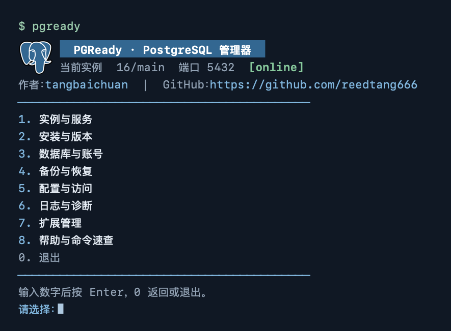

<p align="center">
  
</p>

<h1 align="center">PGReady</h1>

<p align="center"><strong>面向 Linux 服务器的 PostgreSQL 命令行管理器</strong></p>
<p align="center">通过 SSH 打开中文数字菜单，安装 PostgreSQL、管理实例与账号、备份恢复数据。</p>

<p align="center">
  <a href="#服务器安装">服务器安装</a> ·
  <a href="#功能菜单">功能菜单</a> ·
  <a href="https://github.com/9star-academy/PGReady/releases/latest">最新发布</a>
</p>

<p align="center">
  
</p>

<p align="center"><sub>Ubuntu 实跑菜单。大象图标可在 Kitty 和 Ghostty 中显示。</sub></p>

## 服务器安装

适用于 **Ubuntu 22.04、24.04、26.04 LTS** 和 **Debian 12、13**，支持 **amd64 / arm64**。SSH 登录后，准备好 Bash、`curl` 和 `sha256sum`，使用 root 或具备 sudo 权限的账号。

### 1. 安装 PGReady

**国内服务器**（镜像优先）

```bash
(pgready_bootstrap=$(curl -fsSL https://cdn.jsdelivr.net/gh/9star-academy/PGReady@main/scripts/bootstrap.sh) && PGREADY_DOWNLOAD_MODE=cn bash -c "$pgready_bootstrap")
```

**国外服务器**（GitHub 优先）

```bash
(pgready_bootstrap=$(curl -fsSL https://raw.githubusercontent.com/9star-academy/PGReady/main/scripts/bootstrap.sh) && PGREADY_DOWNLOAD_MODE=auto bash -c "$pgready_bootstrap")
```

`cn` 优先镜像，`auto` 优先 GitHub。安装脚本、校验文件和程序包下载或校验失败时会切换线路。把国外命令中的 `auto` 改成 `direct` 即可仅使用 GitHub。如需更换默认镜像 `https://gh-proxy.com`，可在执行前设置 `PGREADY_GITHUB_MIRROR`。

引导脚本先检查 Linux 发行版、版本与 CPU 架构，遇到不支持的环境会提示检测结果并退出。通过检查后，引导脚本按固定 SHA-256 校验安装器，安装器核对程序的 SHA-256 和版本并安装到 `/usr/local/bin/pgready`。

### 2. 验证并打开菜单

```bash
pgready --version
pgready status
pgready
```

版本应显示 `pgready v0.1.2`。`pgready status` 会列出 APT 管理的本机实例及其端口和状态。空机可在菜单选择 `2. 安装与版本 → 3. 安装 PostgreSQL`。如果找不到可安装的软件包，先执行 `sudo apt-get update` 刷新软件源索引。

## 功能菜单

输入数字并按 Enter。主菜单的 `0` 退出，子菜单的 `0` 返回上一级。

<details>
<summary><strong>1. 实例与服务</strong> · 切换实例、查看运行状态、启停与重启</summary>

1. **列出与切换实例** — 识别本机已注册的 PostgreSQL 集群，包括已停止的实例。
2. **查看当前实例** — 显示版本、集群名、端口、数据目录、服务状态和连接就绪情况。指定账号的登录可在「数据库与账号」单独测试。
3. **启动实例** — 启动当前实例并检查是否接受连接。
4. **停止实例** — 显示目标实例和连接中断提示，确认后停止。
5. **重启实例** — 确认后重启当前实例，重新检查服务和连接。

</details>

<details>
<summary><strong>2. 安装与版本</strong> · 安装 PostgreSQL、查看可用版本与补丁</summary>

1. **检查安装环境** — 显示系统版本、软件包来源和已经识别到的 PostgreSQL 实例。
2. **查看可安装版本** — 列出当前软件源提供的 PostgreSQL 主版本。
3. **安装 PostgreSQL** — 在新服务器上选择版本，确认后通过 APT 安装，再检查新实例状态。
4. **检查补丁更新** — 显示当前主版本的已安装版本和可用补丁版本。

后续计划支持应用补丁更新。跨主版本迁移单独设计，包含扩展兼容性检查、备份恢复验证和切换步骤。

</details>

<details>
<summary><strong>3. 数据库与账号</strong> · 建库、创建账号、管理连接权限</summary>

1. **列出数据库** — 查看数据库名、所有者和大小。
2. **创建数据库** — 输入数据库名并指定所有者。
3. **列出账号与角色** — 查看登录权限、角色属性和成员关系。
4. **创建应用账号** — 在终端设置密码，为新角色授予指定数据库的 `CONNECT` 权限。表和模式权限按业务需要分配。
5. **调整密码与权限** — 为选定角色修改密码，查看、授予或撤销显式 `CONNECT` 权限。实际访问也受 `PUBLIC` 和角色继承影响。
6. **测试登录** — 通过本机 IPv4 回环地址连接，核对目标实例、数据库和登录角色。

</details>

<details>
<summary><strong>4. 备份与恢复</strong> · 单库备份、恢复到新库、核对数据</summary>

1. **备份指定数据库** — 选择来源实例、数据库和保存位置，使用 `pg_dump` 生成归档。
2. **查看备份** — 查看本地备份文件的路径、时间和大小，使用 `pg_restore --list` 查看归档内容。
3. **恢复到新库** — 选择备份文件与目标实例，创建新数据库后执行恢复。
4. **验证恢复结果** — 输入模式和表名，查询行数后与预期结果核对。

首版备份范围为单个数据库。角色和表空间属于实例级对象，需要单独备份。恢复会执行归档中的 SQL，请选择可信来源的备份，并确认目标环境具备所需的角色和扩展。恢复失败时新库会保留。

</details>

<details>
<summary><strong>5. 配置与访问</strong> · 查看数据目录、端口与客户端认证</summary>

1. **查看目录与配置文件** — 显示数据目录、`postgresql.conf` 和 `pg_hba.conf` 的实际路径。
2. **查看监听与端口** — 显示端口、监听地址和本地 Socket 目录。
3. **查看客户端认证** — 按顺序显示 `pg_hba.conf` 的规则和可读取的解析状态。
4. **查看生效参数** — 查看常用参数的当前值和来源，标明是否还有改动等待重启生效。

首版提供只读检查。后续计划支持修改指定参数和认证规则，应用前显示变更，应用后用新连接验证。

</details>

<details>
<summary><strong>6. 日志与诊断</strong> · 排查慢查询、连接、锁与磁盘</summary>

1. **查看服务日志** — 读取当前实例可定位的日志文件，查看近期启动、连接或认证错误。
2. **查看慢查询日志** — 检查慢查询日志是否开启，从近期日志中查找达到配置阈值的耗时记录。
3. **查看连接与活动** — 按数据库查看连接数、活跃会话和运行较久的事务。
4. **查看锁与阻塞** — 找出正在等待的会话以及阻塞它的会话。
5. **检查存储空间** — 查看数据库大小，以及数据目录所在文件系统的剩余空间。

</details>

<details>
<summary><strong>7. 扩展管理</strong> · 查看可用和已启用的扩展</summary>

1. **查看可用扩展** — 查看当前实例可用的扩展及版本。
2. **查看已启用扩展** — 选择数据库，查看其中已启用的扩展及版本。

首版提供查询。后续计划支持按需安装系统扩展包，并在指定数据库中启用扩展。

</details>

<details>
<summary><strong>8. 帮助与命令速查</strong> · 连接数据库、查询常用指令、排查连接问题</summary>

1. **快速上手** — 讲解如何选择实例、连接数据库、查看当前连接和退出 `psql`。连接示例使用当前实例的端口等连接信息，并标明需要填写的账号和库名。
2. **常用命令** — 标明每条命令的输入位置，附上示例和预期结果。

   | 输入位置 | 命令 | 用途 |
   | --- | --- | --- |
   | SSH 终端 | `pgready` | 打开 PGReady 主菜单 |
   | `psql` 内 | `\conninfo` | 查看当前连接 |
   | `psql` 内 | `\l` | 列出数据库 |
   | `psql` 内 | `\dt` | 列出当前搜索路径中可见的表 |
   | `psql` 内 | `\d 表名` | 查看指定表的结构 |
   | `psql` 内 | `\du` | 列出角色 |
   | `psql` 内 | `\q` | 退出 `psql` |

3. **常见问题** — 按服务状态、连接地址与端口、账号认证和数据库权限排查连接失败。

</details>

## 开发与验收

<details>
<summary>从源码构建与验收</summary>

在目标 Linux 主机上使用 Go 1.22 或更新版本构建。

```bash
go build -o /tmp/pgready ./cmd/pgready
/tmp/pgready --help
/tmp/pgready status
/tmp/pgready
```

- **本地检查** — 运行 `go test -race ./...`、`go vet ./...` 和 `bash scripts/install_test.sh`。测试覆盖发行版检查、多实例选择、取消与目标核对、SQL 参数转义、归档冲突和恢复失败。
- **新服务器** — 从 `2` 安装 PostgreSQL，用 `3` 建库和创建应用账号，确认该账号能登录并执行查询。再通过 `4` 备份并恢复到新库，核对原库和恢复库的表及样例数据。
- **已有两个实例的服务器** — 在 `1` 选中测试实例后执行服务操作，核对选中实例的状态变化，并查询另一个实例确认仍可用。
- **初次使用 PostgreSQL** — 在 `8` 找到当前实例的连接示例，在 SSH 终端连接，进入 `psql` 后用 `\conninfo` 核对目标。

</details>

九星学院项目 · [tangbaichuan](https://github.com/reedtang666)
